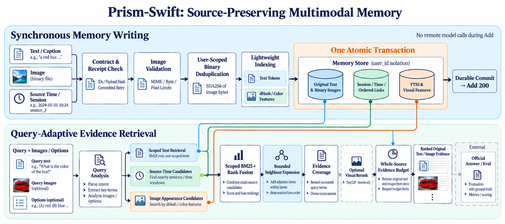
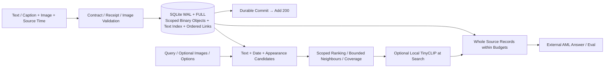

# Prism-Swift

**Fast multimodal memory with synchronous durable writing and optional visual reranking at Search.**

Prism-Swift stores original text, images, order and source metadata, indexes the captions/text
already supplied by the caller, and returns real evidence through AML Add/Search.
The default service has **no remote model dependency, no learned embedding and no GPU requirement**.
Optional TinyCLIP runs locally during visual Search; it is never called by Add.

**Status:** implemented and locally tested, including a real Docker build, immediate image
retrieval, restart and SIGKILL recovery. Public deployment and official Smoke/Full are **not run**.
See [actual results and limits](docs/performance_report.md), [contract](docs/competition_contract.md),
[deployment](docs/deployment_guide.md) and [submission](SUBMISSION_GUIDE.md).

## Why this system

Repeated visual-language calls can make Add depend on upstream latency and limits even when
the platform already supplies captions. Binary image objects also avoid repeated Base64
storage. This implementation preserves source evidence and commits all indexes and receipts
before success. It does not acknowledge an unfinished queue.

The default retrieval uses user-scoped lexical statistics, source dates, image hashes/colors,
bounded same-session neighbours and coverage for broad queries. These are established techniques,
not a claim of a novel general memory algorithm. [V-Mem and other closest work](docs/related_work.md)
limit the novelty claim. The engineering contribution is an audited, measurable implementation
of source fidelity, synchronous persistence and bounded retrieval cost. Real QA benefit is unproven.

## Architecture





The editable Mermaid sources and ImageGen prompts are in [figures](figures/).
Dashed visual modules in the PNG require the optional visual profile.

## Writing and storage

- Ordered text/image parts, JPEG/PNG/WebP Data URIs, source timestamps in Unix milliseconds.
- SQLite WAL with `synchronous=FULL`; raw templates, scoped image BLOBs, links, FTS and receipt
  commit in one transaction. No source is silently truncated.
- Images deduplicate by **(user_id, SHA256)**. Source occurrences remain separate events.
- A committed identical request retry returns its receipt; changed payload returns 409.
- Keep a factory-thread connection alive to avoid recreating/checkpointing WAL after every HTTP request.
- New project/database: no automatic migration or replacement of an existing official Full service.

## Retrieval

- FTS5 generates candidates; final lexical statistics are computed within the requesting user.
  Global FTS5 BM25 statistics are deliberately not used for ranking.
- Weak options channel, ISO source dates, latest source time, exact-image/appearance candidates.
- Optional query-only TinyCLIP reranking has explicit source/image/byte budgets and no persisted query cache.
- Return complete original source items in ranked order, within `top_k` and the 30 MiB media budget.
  Search returns evidence, never an answer.

Cheap visual features cannot understand arbitrary objects, OCR or relations. The synthetic
uncaptioned shape test exposes that limitation; no official score or competitive rank is claimed.
See [method details](docs/method.md) and [benchmark analysis](docs/benchmark_analysis.md).

## Environment and installation

Default: Python 3.11, SQLite with FTS5/JSON1, FastAPI, Uvicorn, Pillow. No CUDA or model SDK.
CPU server target: the existing 2 CPU / 3.5 GiB machine, initially Add 2 / Search 2.
Local affinity tests are not proof of its cloud disk, network or Full capacity.

```bash
git clone YOUR_PUBLIC_REPOSITORY_URL Prism-Swift
cd Prism-Swift
python3 -m venv .venv
. .venv/bin/activate
pip install -r requirements-dev.txt
export PYTHONPATH=src
python -B -m unittest discover -s tests -v
```

## Run locally

```bash
export PYTHONPATH=src
export MEMORY_API_KEY=local-development-only
export PRODUCTION=1
export MEMORY_DB_PATH=data/local.sqlite3
export MIN_FREE_BYTES=0
export HOST=127.0.0.1 PORT=8003
python -m prism_swift.api
```

In another terminal with the same development key:

```bash
export MEMORY_API_KEY=local-development-only
python scripts/smoke_test.py --base-url http://127.0.0.1:8000 --phase all --state state-local.json
```

Use a fresh random secret for production. `.env` is read by Docker Compose, not automatically by Python.

## API

`GET /health` is public. `POST /add`, `POST /search` and `GET /metrics` require
`Authorization: Token <MEMORY_API_KEY>` (Bearer and X-Api-Key also supported).

```json
{"request_id":"example-1","user_id":"example-user","session_id":"s1",
 "messages":[{"role":"user","content":"Alice put the blue cup on the desk.","timestamp":1792022400000}]}
```

```json
{"success":true,"request_id":"example-1","user_id":"example-user","session_id":"s1"}
```

```json
{"query":"Where is Alice's blue cup?","user_id":"example-user","top_k":100}
```

```json
{"data":[{"id":"swift_<stable hash>","content":"Alice put the blue cup on the desk.",
          "score":0.05,"created_at":"2026-10-15T00:00:00+00:00"}]}
```

These are format examples, not measured retrieval output. Multimodal content/query may be
`[{"type":"text","text":"caption"},{"type":"image_url","image_url":{"url":"data:image/png;base64,..."}}]`.
See [participant-side schemas](config/api.schema.json) and the [official contract](docs/competition_contract.md).

## Docker deployment

Create a private `.env` from the template and set a random `MEMORY_API_KEY` and real `SOURCE_COMMIT`.
The default container uses independent port **8003** and volume **prism_swift_data**.

```bash
sh scripts/deploy.sh
curl --noproxy '*' --connect-timeout 5 --max-time 10 http://127.0.0.1:8003/health
```

The script starts Compose after checking configuration. Bootstrap initializes the new data
directory and execs the application as UID/GID10001, root filesystem read-only.
Do not use `docker compose down -v` on retained data.

Full new-server installation, public networking/HTTPS, private configuration, restart,
backup and error diagnosis are in [deployment guide](docs/deployment_guide.md).
The [optional visual guide](docs/visual_reranker.md) distinguishes tested CPU code and the
optional Docker image that still needs its own build/capacity acceptance.

## Evaluation and reproduction

```bash
PYTHONPATH=src python scripts/benchmark.py --mode all --cores 2 --ablations \
  --output results/my-benchmark.json
PYTHONPATH=src python scripts/scale_benchmark.py --messages 10000 \
  --output results/my-scale.json
python scripts/container_check.py --output results/my-container-check.json
```

Install development dependencies for profiling. Tests and scripts use generated images only.
Raw results, platform, source hashes, seeds and limits are included. TinyCLIP comparisons
need its pinned public model and separate dependencies; weights are excluded from this repository.
Recall/MRR/NDCG here describe developer diagnostics, not AML Answer/Eval accuracy.

Estimate completion with **actual request counts**, not the public 5000-instance headline:

```bash
python scripts/estimate_completion.py --report results/prism-benchmark-20261016.json \
  --add-requests 10000 --search-requests 5000
```

Those counts are examples. Total runtime stays unknown unless platform Answer/Eval and queue
times are supplied. The calculator separates optimistic/central/conservative assumptions.

## Competition submission

Default zero-model academic eligibility is not explicitly settled by the public wording;
the Industrial/Commercial route permits noncommercial open-source work. TinyCLIP requires
an eligible declared configuration; do not assume the academic fixed-model policy permits it.

Freeze and publicly publish the real Git commit, deploy matching code, run technical checks,
then official Smoke. Existing Full jobs/credits require organizer handling; a new name does
not authorize replacing a frozen run or creating another Full.

## Relationship, license and limitations

This new project follows the original Chronicle-Memory's source/time/receipt principles,
but replaces its production schema, ingestion and serving path. Historical source credit is
retained in [ATTRIBUTION.md](ATTRIBUTION.md); the project brand is Prism-Swift. MIT license.

No paid memory inference API, public deployment or official evaluation was run.
ImageGen produced the diagrams; optional TinyCLIP was tested locally on CPU.
Natural-image retrieval, real cloud Full scale, official results and novel research benefit
remain unverified. Source role/session are retained in storage; original content is returned
without an invented provenance header. Whether optional metadata reaches the official
answerer's prompt is not assumed. Respect the official evaluation-data retention deadline;
the service does not automatically delete existing memories or backups.
